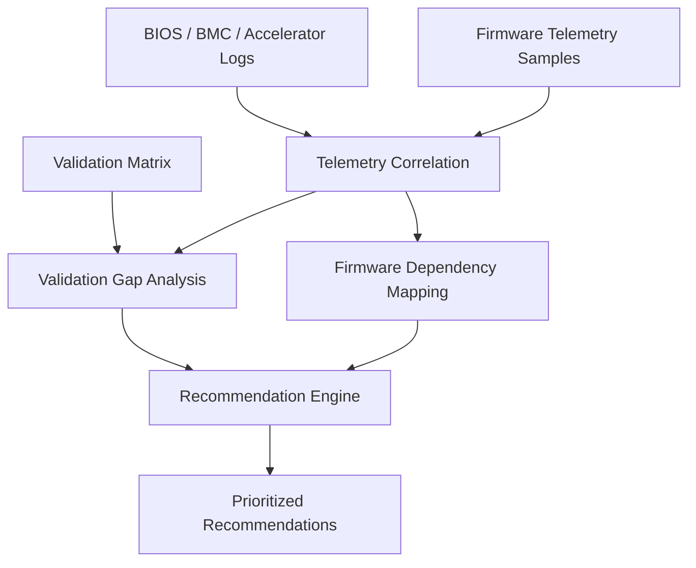

# AI Accelerator Reliability Intelligence (AI-RI)

[](https://github.com/Yao-heng/ai-accelerator-reliability-intelligence/actions/workflows/ci.yml)

A FastAPI prototype that encodes 24 years of platform firmware and RAS
(Reliability, Availability, Serviceability) diagnostic experience into a
deterministic reliability-analysis service: it ingests multi-layer platform
logs and accelerator telemetry, correlates them in time, detects anomalies,
scores risk, maps firmware blast radius, finds validation coverage gaps, and
emits prioritized, evidence-backed recommendations.

The design premise is simple: when a node fails, the evidence is scattered
across host BIOS machine-check records, BMC system event logs, and accelerator
telemetry — and the first diagnostic problem is fusing those fragments into
one timeline an engineer can act on. AI-RI implements that fusion and triage
workflow end to end against bundled sample data.

---

## Implementation Status (read this first)

This repository is a **working prototype**. It runs today, it is covered by
automated tests, and its scope is stated plainly:

**Implemented and runnable**

- FastAPI service with structured log parsing, telemetry
  ingestion/normalization, temporal correlation, threshold-based anomaly
  detection, deterministic risk scoring, firmware dependency (blast-radius)
  mapping, validation gap analysis, and a rule-based recommendation engine
- Bundled sample data (GPU telemetry, platform logs, validation matrix,
  firmware dependency manifest) plus captured example API responses under
  `examples/`
- Automated tests (`pytest`, see `tests/`), type checking (`mypy` with
  required annotations), CI (GitHub Actions), and a smoke test script
  (`python scripts/run_analysis_smoke_test.py`)

**Deliberately out of scope for this prototype**

- All analysis is **deterministic and rule-based**; thresholds and failure
  signatures live in `app/services/` and run against the bundled sample data
- No live BMC / Redfish / PLDM collectors, no LLM or RAG inference, and no
  infrastructure actuation (power capping, node evacuation). Those are
  roadmap items — see the Roadmap section below — not shipped features

---

## Why This Exists

Reliability failures in dense compute platforms are cross-layer events. A
single hardware or fabric fault can surface as a host-side machine check, a
fragmented BMC event log, and accelerator-side error counters at the same
moment — while the operational symptom is a stalled distributed workload.
Traditional triage starts from isolated logs and burns hours reconstructing
what happened.

AI-RI takes the position that the first pass of that reconstruction is
mechanical and should be automated: parse every layer into a common schema,
align events to the telemetry around them, classify the failure mode against
known signatures, and hand the engineer a ranked recommendation with the
evidence attached. The judgment encoded in the rules comes from real
platform bring-up and field-RCA work — server BIOS/RAS ownership on HP
ProLiant platforms (including the ultra-dense Moonshot 1500) and a decade of
client platform firmware leadership at Dell.

---

## Diagnostic Approach

The pipeline follows the same three steps a senior platform engineer runs
manually, made explicit and repeatable:

1. **Deterministic signature identification.** Structured log lines and
   telemetry samples are parsed into canonical domain objects. Failure
   signatures — uncorrectable HBM ECC escalation, PCIe replay storms, fabric
   CRC bursts, thermal boundary oscillation, power overshoot — are matched
   against explicit thresholds and event codes, not inferred by a black box.
2. **Temporal correlation.** Warning, error, and critical log events are
   aligned to the nearest telemetry samples for the same accelerator and
   firmware version, so each incident carries the platform state (temperature,
   power, error counters, latency) observed around it.
3. **Rule-based recommendation.** Correlated incidents are combined with
   validation-gap and firmware blast-radius analysis to produce prioritized
   recommendations, each with a title, rationale, supporting evidence,
   affected components, expected impact, and concrete next steps.

Errata knowledge retrieval (RAG) and LLM-assisted reasoning are natural
extensions of step 3 — and are listed under Roadmap precisely because they
are **not** implemented here.

---

## Core Capabilities (as implemented)

- **Telemetry ingestion & normalization** — broad field aliases are mapped
  into a canonical Pydantic schema, so downstream stages see one shape of
  data regardless of source formatting.
- **Cross-layer log parsing** — firmware and OS log lines are converted into
  structured records preserving subsystem, event code, firmware version,
  rack, and metadata.
- **Temporal correlation** — log events are bound to the telemetry samples
  nearest in time for the same accelerator/firmware pair, with per-metric
  status and a failure-mode classification.
- **Threshold-based anomaly detection** — uncorrected HBM ECC, PCIe replay
  counts, fabric CRC errors, temperature, power, and latency are
  checked against warning/critical thresholds.
- **Deterministic risk scoring** — anomalies are aggregated into 0–100 risk
  scores per accelerator (each score carries its rack id) for triage ordering.
- **Firmware dependency mapping** — a firmware integration manifest is
  turned into dependency adjacency and blast-radius views across runtime,
  driver, hardware, and fleet surfaces.
- **Validation gap analysis** — observed failure modes are compared against
  the release validation matrix to expose missing coverage by firmware
  version and workload phase.
- **Recommendation engine** — incidents, gaps, and blast radius are fused
  into prioritized recommendations with rationale and evidence.

---

## Project Structure

```text
app/
  api/
    routes.py                     # REST routes under /api/v1
  data/
    accelerator_logs.log          # Raw multi-layer firmware and OS log lines
    firmware_dependencies.json    # Manifest mapping subsystem blast radius and adjacency
    gpu_telemetry_logs.jsonl      # GPU fleet telemetry stream samples
    telemetry_samples.json        # Normalized telemetry samples
    validation_matrix.json        # Release validation test coverage matrix
  models/
    schemas.py                    # Pydantic domain models
  services/
    anomaly_detector.py           # Threshold monitoring for HBM ECC, PCIe replays, fabric CRC, thermals, power
    analyzer.py                   # Orchestrates the full analysis pipeline
    data_repository.py            # Local sample-data access layer
    firmware_dependency_mapper.py # Blast-radius calculation across runtime and firmware layers
    infrastructure_advisor.py     # Higher-level operations advisories (rollout freezes, quarantines)
    log_parser.py                 # Converts raw log lines into domain objects
    recommendation_engine.py      # Emits root-cause hypotheses and actionable recommendations
    risk_scoring.py               # Aggregated 0-100 risk scores for rack and node triage
    telemetry_correlator.py       # Aligns log events to nearest telemetry samples
    telemetry_ingestion.py        # Normalizes field aliases into canonical schemas
    validation_gap_analyzer.py    # Finds missing test coverage for workload phases and platforms
  main.py                         # FastAPI application entrypoint
src/
  intelligence_analyzer.py        # LEGACY / UNUSED early draft, kept for reference — the app does not import it (see app/services/)
docs/
  PROJECT_PLAN.md
  firmware_dependency_mapping.md
  telemetry_correlation.md
  validation_gap_analysis.md
examples/
  api_responses/                  # Captured responses for every endpoint
  sample_outputs/                 # Generated analysis outputs
scripts/
  generate_examples.py            # Regenerates examples/ from the sample data
  run_analysis_smoke_test.py      # End-to-end smoke test of the analyzer pipeline
tests/
  test_api.py                     # API integration tests (8 tests)
  test_services.py                # Unit tests for anomaly, risk, and log parsing services (7 tests)
  test_telemetry_ingestion.py     # Unit tests for telemetry parsing, alias normalization, summaries (10 tests)
  test_data_repository.py         # Unit tests for sample-data JSON shape validation (4 tests)
.github/workflows/
  ci.yml                          # GitHub Actions CI: mypy + pytest + smoke test on Python 3.12
requirements.txt                  # Runtime dependencies only (FastAPI, Uvicorn, Pydantic)
requirements-dev.txt              # Runtime + test dependencies (pytest, httpx, mypy)
pyproject.toml                    # Project metadata; [project.optional-dependencies] dev mirrors requirements-dev.txt
LICENSE                           # Apache-2.0
```

---

## Quick Start

Requires Python 3.11 or newer. Run everything from the project root
(the directory containing `app/` and `pyproject.toml`).

### 1. Create a virtual environment and install dependencies

macOS / Linux:

```bash
python3 -m venv .venv
source .venv/bin/activate
python -m pip install --upgrade pip
pip install -r requirements.txt
```

Windows (PowerShell):

```powershell
py -m venv .venv
.venv\Scripts\Activate.ps1
python -m pip install --upgrade pip
pip install -r requirements.txt
```

`requirements.txt` contains only the runtime dependencies (FastAPI,
Uvicorn, Pydantic) — it is enough to run the service.

### 2. Run the service

```bash
uvicorn app.main:app --reload --host 127.0.0.1 --port 8000
```

Then open:

- API docs: `http://127.0.0.1:8000/docs`
- Health check: `http://127.0.0.1:8000/health` — returns
  `{"status": "ok", "service": "ai-accelerator-reliability-intelligence"}`

### 3. Run the tests and the smoke test

The test suite needs the development dependencies (`pytest`, `httpx`),
which are **not** in `requirements.txt`:

```bash
pip install -r requirements-dev.txt
pytest
python scripts/run_analysis_smoke_test.py
```

Expected results (verified against the bundled sample data):
`pytest` reports **29 passed**, and the smoke test prints:

```text
Smoke test completed successfully.
Samples: 5
Accelerators: 5
Anomalies: 8
Risk scores: 5
Recommendations: 5
```

The smoke test analyzes `app/data/telemetry_samples.json` (via
`DataRepository.load_telemetry()`) and writes its full output to
`scripts/output/analysis_response.json`. The top risk score in that run
is `accel-c91` in `rack-14` at **100/100 (critical)**, driven by
`fabric_crc_errors=14`, `power_watts=641.5`, and
`inference_latency_ms=57.9` during `allreduce-gradient-sync`.

### Docker (development mode)

Run from the project root. macOS / Linux:

```bash
docker run --rm -it \
  -v "$(pwd):/app" \
  -w /app \
  -p 8000:8000 \
  python:3.12-slim \
  bash -lc "pip install -r requirements.txt && uvicorn app.main:app --host 0.0.0.0 --port 8000"
```

On Windows, replace `$(pwd)` with `%cd%` (cmd) or `${PWD}` (PowerShell).

### Troubleshooting

- `uvicorn` missing → reinstall dependencies: `pip install -r requirements.txt`.
- `pytest` missing → install the dev dependencies: `pip install -r requirements-dev.txt`.
- Import path failures → run from the project root so the local `app`
  package is on the Python path.
- `Telemetry payload failed schema validation` → check payload fields
  against `app/models/schemas.py`.
- Smoke test failures → confirm `app/services/analyzer.py` and
  `app/services/telemetry_ingestion.py` are present and `DataRepository`
  can load the sample JSON files under `app/data/`.

---

## API Endpoints

Verified against `app.routes` (FastAPI's built-in `/docs`, `/redoc`, and
`/openapi.json` are also served):

- `GET /health` — `{"status": "ok", "service": "ai-accelerator-reliability-intelligence"}`
- `GET /api/v1/logs/parsed` — 6 parsed log entries from the bundled sample data
- `GET /api/v1/telemetry/correlated` — 6 correlated events
- `GET /api/v1/validation/gaps` — 4 validation gaps
- `GET /api/v1/firmware/dependencies` — dependency map with 6 components
- `GET /api/v1/recommendations` — 6 recommendations
- `POST /api/v1/analyze` — analyze a telemetry payload, or the bundled
  GPU telemetry stream when the body is empty (see below)
- `POST /analyze` (root alias of `POST /api/v1/analyze`)

Counts above are for the bundled sample data and are reproduced in
`examples/api_responses/`.

## Example API Requests

Analyze with a sample telemetry payload:

```bash
curl -X POST "http://127.0.0.1:8000/api/v1/analyze" \
  -H "Content-Type: application/json" \
  -d '{
    "telemetry": [
      {
        "timestamp": "2026-05-28T10:00:00Z",
        "accelerator_id": "accel-a17",
        "rack_id": "rack-01",
        "firmware_version": "7.5.0-rc2",
        "workload_id": "job-123",
        "workload_phase": "kv-cache-spill",
        "temperature_c": 89.2,
        "hbm_ecc_corrected": 0,
        "hbm_ecc_uncorrected": 1,
        "pcie_replay_count": 1200,
        "power_watts": 655.0,
        "fabric_crc_errors": 3,
        "inference_latency_ms": 47.4
      }
    ]
  }'
```

Analyze from the bundled telemetry sample data:

```bash
curl -X POST "http://127.0.0.1:8000/api/v1/analyze" \
  -H "Content-Type: application/json" \
  -d '{}'
```

With an empty body the endpoint analyzes
`app/data/gpu_telemetry_logs.jsonl` (note: a different dataset from the
smoke test's `telemetry_samples.json`). The real response begins:

```json
{
  "ingestion": {
    "source": "jsonl",
    "sample_count": 6,
    "accelerator_count": 5,
    "rack_count": 5,
    "firmware_versions": ["7.4.1", "7.4.2", "7.5.0-rc2"],
    "workload_phases": [
      "allreduce-gradient-sync",
      "batch-size-step",
      "host-dma-burst",
      "prefill-ramp",
      "sustained-inference"
    ],
    "time_range": {"start": "2026-05-13T03:11:02Z", "end": "2026-05-13T03:21:28Z"}
  },
  "anomalies": [
    {
      "anomaly_id": "ANOM-0001",
      "timestamp": "2026-05-13T03:11:02Z",
      "accelerator_id": "gpu-r22-a17",
      "rack_id": "rack-22",
      "firmware_version": "7.4.2",
      "workload_id": "llm-serving-prod-774",
      "workload_phase": "prefill-ramp",
      "metric": "temperature_c",
      "value": 87.4,
      "threshold": 86,
      "severity": "warning",
      "failure_mode": "thermal_throttle_boundary",
      "description": "temperature_c=87.4 crossed 86 on gpu-r22-a17 during prefill-ramp."
    }
  ]
}
```

In full, that response contains 13 anomalies, 5 risk scores, and 5
recommendations; the complete captured response is in
`examples/api_responses/POST_api_v1_analyze.json`. The single-sample
request above returns 6 anomalies (one per checked metric), a risk
score of 100/100 (critical) for `accel-a17`, and 1 recommendation.

Use the analyzer directly from Python (run from the project root):

```python
from app.services.analyzer import ReliabilityAnalyzer
from app.services.data_repository import DataRepository

repository = DataRepository()
payload = repository.load_telemetry()
response = ReliabilityAnalyzer().analyze(payload)
print(response.model_dump(mode="json"))
```

This is exactly what `scripts/run_analysis_smoke_test.py` runs; its
summary output is shown in Quick Start above.

---

## Architecture

The application is split into thin API routes, shared Pydantic domain
models, a local sample-data access layer, and focused reliability services.

`LogParser` converts structured firmware log lines into `AcceleratorLogEntry`
records, preserving subsystem, event code, firmware version, rack, and
key-value metadata so later stages can reason about operational context.

`TelemetryCorrelator` links warning, error, and critical log events to the
nearest telemetry samples for the same accelerator and firmware version. It
flags anomalous signals such as uncorrectable HBM ECC, PCIe replay storms,
fabric CRC bursts, thermal boundary crossings, power overshoot, and latency
impact, and classifies each incident's failure mode with a confidence value.

`ValidationGapAnalyzer` compares correlated failure modes against the sample
validation matrix, identifying missing coverage for firmware versions,
workload phases, and newly observed failure modes.

`FirmwareDependencyMapper` turns a firmware integration manifest into
dependency adjacency and blast-radius views, explaining which runtime,
driver, hardware, and fleet surfaces a subsystem issue may affect.

`RecommendationEngine` combines correlated incidents, validation gaps, and
dependency blast radius into prioritized reliability recommendations with
rationale, evidence, affected components, expected impact, and next steps.

## Reliability Workflow



## Example Findings (from the bundled sample data)

The sample data exercises the pipeline with:

- Correlated HBM ECC escalation on `accel-a17` during `kv-cache-spill`
- PCIe replay storm on `accel-b03` during `host-dma-burst`
- Fabric CRC burst on release-candidate firmware `7.5.0-rc2`
- Thermal throttle boundary oscillation under sustained inference
- Power transient overshoot during an LLM prefill batch-size step

Validation gap examples include missing coverage for:

- HBM ECC escalation on firmware `7.4.2` during `kv-cache-spill`
- Fabric CRC burst on firmware `7.5.0-rc2` during `allreduce-gradient-sync`
- Thermal throttle boundary behavior on firmware `7.4.2` during `sustained-inference`

The first recommendation emitted by the smoke-test run (see Quick
Start; analysis of `app/data/telemetry_samples.json`), verbatim from
`scripts/output/analysis_response.json`:

```json
{
  "recommendation_id": "OPS-0001",
  "priority": "critical",
  "title": "Contain accel-c91 critical infrastructure risk",
  "rationale": "accel-c91 in rack-14 reached risk score 100/100 from 3 telemetry anomaly signal(s).",
  "evidence": [
    "power_watts=641.5 crossed 640 on accel-c91 during allreduce-gradient-sync.",
    "fabric_crc_errors=14 crossed 12 on accel-c91 during allreduce-gradient-sync.",
    "inference_latency_ms=57.9 crossed 45 on accel-c91 during allreduce-gradient-sync."
  ],
  "affected_components": [
    "accelerator interconnect fabric",
    "serving runtime SLO path",
    "rack power delivery"
  ],
  "expected_impact": "Prevent accelerator resets, workload evacuation, and correlated rack incidents.",
  "next_steps": [
    "Attach the telemetry envelope to the incident ticket and freeze firmware rollout for the affected rack.",
    "Compare the accelerator against same-rack peers for correlated power, thermal, and fabric signals.",
    "Run rack power headroom verification before allowing larger prefill batches.",
    "Drain or quarantine the accelerator until replay validation passes."
  ]
}
```

Recommendations use the `ReliabilityRecommendation` schema defined in
`app/models/schemas.py`.

## Regenerate Example Outputs

```bash
python scripts/generate_examples.py
```

Generated outputs are stored in `examples/sample_outputs/` and mirrored as
captured API responses in `examples/api_responses/`.

---

## Roadmap (not implemented)

These are design directions, stated explicitly as future work:

- **Live ingestion** — Redfish / IPMI / PLDM collectors and streaming
  telemetry adapters replacing the bundled sample-data repository.
- **Errata knowledge retrieval** — indexing silicon errata and field RCA
  notes (RAG) so recommendations can cite documented workarounds.
- **LLM-assisted reasoning** — an advisory layer on top of the deterministic
  engine for narrative triage summaries; the rule engine remains the source
  of record.
- **Fleet baseline comparison** — cohort-level baselines to separate
  single-node degradation from fleet-wide regressions.
- **Closed-loop mitigation** — integrations for ticketing and, eventually,
  guarded actuation (power capping, node quarantine) behind human approval.

## Extensibility Notes

- Replace `DataRepository` with adapters for log stores, telemetry streams,
  release validation systems, or firmware manifest registries.
- Add richer time-window correlation in `TelemetryCorrelator` when real
  event timestamps and sample cadence are available.
- Expand `ValidationGapAnalyzer` with stale-test detection, environment
  matching, and release-blocking policy.
- Connect `RecommendationEngine` to ticketing or incident tooling once
  ownership and escalation rules are defined.

## License

MIT — see [`LICENSE`](LICENSE).
